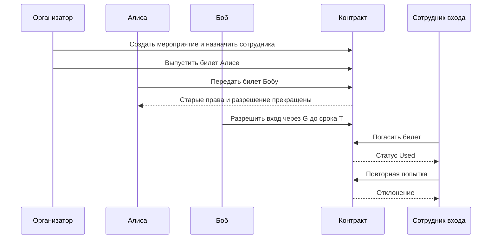

# TicketCheck — план Final

## Что уже определено

Тема остаётся прежней: выпуск и проверка билетов для организаторов и площадок.
Добавляем передачу владельцем и короткое разрешение на вход конкретному сотруднику.
Заказчик услуги — организатор, пользователи — организатор, посетитель и сотрудник входа.
Перепродажа за деньги, возвраты и токен не входят в текущую реализацию.

Ключевой вопрос защиты: зачем общий реестр, если достаточно базы данных?
Наше условное обоснование — независимые организаторы и площадки совместно проверяют
состояние билетов. Если всем управляет одна доверенная компания, обычная база данных
может быть проще и дешевле. Наличие спроса и преимущество блокчейна ещё не доказаны.

## Отличия от Endterm

| Endterm | Final |
| --- | --- |
| Функции контракта только описаны | Есть исходный код и воспроизводимые проверки |
| Статус билета и защита от второго сканирования | Добавлены владелец, передача и разрешение на вход |
| Общие технические риски | Проверяемые ограничения ролей и описанные остаточные риски |
| Оптимистичные предварительные финансовые допущения | Нужны пересчёт, NPV и два пессимистичных сценария |

Преподаватель разрешил небольшие изменения, по сообщению пользователя.
Смена стартапа не предполагается.

## Основной сценарий

## Следующие этапы

1. Разобрать код с участниками и определить вклад каждого.
2. Сделать простой локальный интерфейс: выпуск, передача, разрешение и погашение.
3. Пересчитать экономику обслуживания организаторов. Старые 95 млн KZT не переносить без обоснования.
4. Составить трёхлетние income statement и cash flow; рассчитать NPV при ставке 20–30%,
   безубыточность, срок окупаемости, runway и два пессимистичных сценария.
5. Согласовать расходы на снижение рисков с финансовой моделью.
6. Проверить минимум 10 источников, включая 5 статей с 2021 года из журналов Scopus.
7. Написать 15 страниц основного отчёта, оформить приложения, AI Disclosure и авторство страниц.
8. Создать презентацию на 10 минут, записать демо до 3 минут, подготовить самооценки.
9. Опубликовать код и видео с нужным доступом, проверить ссылки, подготовиться к вопросам.

Отдельно нужны фактический номер команды, замечания после Endterm, точная дата защиты,
подтверждение состава команды и реальное распределение работы. Они не блокируют локальный прототип.

## Чего пока нельзя утверждать

- Нет подтверждённых клиентов, рыночного спроса или согласованных цен.
- Нет внешнего аудита, проверки производительности или готовности к реальной эксплуатации.
- Локальная сеть Hardhat не доказывает работу консенсуса распределённой сети Besu.
- Разрешение владельца не гарантирует физическое присутствие человека.
- Отчёт, презентация, видео и финальная финансовая модель ещё не готовы.
